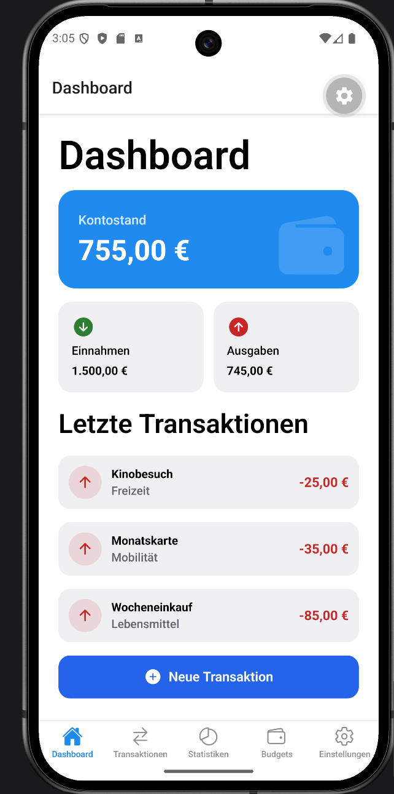
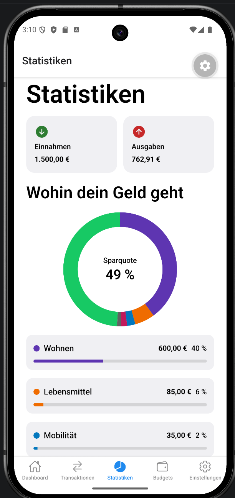
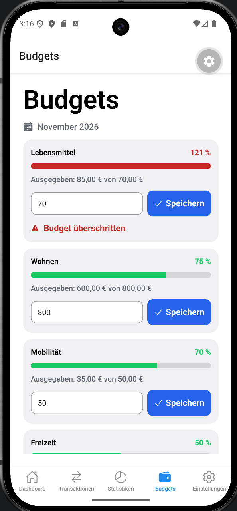
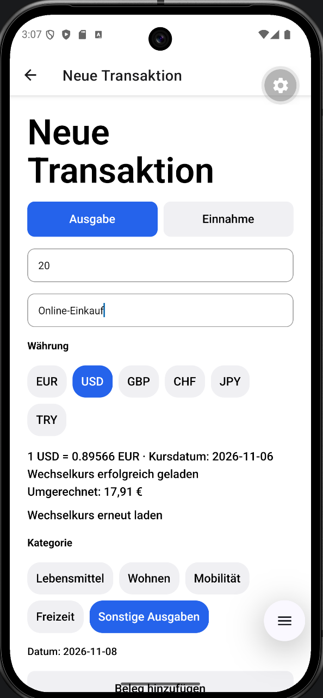
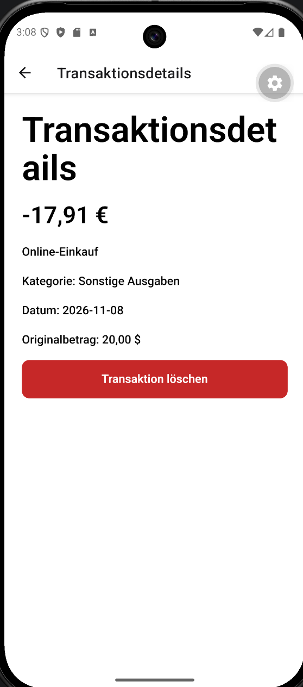

# MoneyTrack

**Einnahmen, Ausgaben und Budgets auf einen Blick.**

MoneyTrack ist ein mobiles Haushaltsbuch mit React Native und Expo. Transaktionen und Belege werden lokal gespeichert. Wechselkurse ermöglichen die Umrechnung von Fremdwährungen in eine gemeinsame Hauptwährung.

[](https://github.com/emrklc04/MoneyTrack/actions/workflows/ci.yml)

**Team:** [emrklc04](https://github.com/emrklc04) · [kokoloko99](https://github.com/kokoloko99)

## Funktionen

| Bereich | Möglichkeiten |
|---|---|
| Dashboard | Einnahmen, Ausgaben, Saldo und letzte Transaktionen ansehen |
| Transaktionen | Einnahmen und Ausgaben mit Kategorie und Beschreibung erfassen, Details öffnen und Einträge löschen |
| Belege | Belege mit der Kamera fotografieren und zur Transaktion speichern |
| Statistiken | Ausgaben nach Kategorien und das Verhältnis von Einnahmen und Ausgaben auswerten |
| Budgets | Monatliche Kategorienbudgets festlegen und Überschreitungen erkennen |
| Währungen | Fremdwährungen umrechnen und die Hauptwährung in den Einstellungen ändern |
| Offline-Nutzung | Lokale Daten und Belege ohne Internet ansehen und Transaktionen in der Hauptwährung erfassen |

Die Navigation besteht aus fünf Tabs sowie einer Detailansicht und einem Formular zum Hinzufügen von Transaktionen.

## Screenshots

Aufnahmen aus dem Android-Emulator mit Beispieldaten. Die Bilder zeigen unterschiedliche Schritte beim Erfassen der Transaktionen; deshalb unterscheiden sich die Summen zwischen Dashboard und Statistik.

### Überblick und Auswertung

| Dashboard | Statistiken | Budgets |
|:---:|:---:|:---:|
|  |  |  |
| Finanzen auf einen Blick | Ausgaben und Sparquote auswerten | Monatslimits im Blick behalten |

### Transaktion mit Fremdwährung

| Neue Transaktion | Transaktionsdetails |
|:---:|:---:|
|  |  |
| Betrag, Kategorie und Währung auswählen | Gespeicherte Angaben und Originalbetrag ansehen |

## Technologie

| Aufgabe | Umsetzung |
|---|---|
| App | React Native 0.88, Expo SDK 58, React 19.3 und TypeScript |
| Navigation | Expo Router |
| State Management | React Context und `useReducer` |
| Lokale Daten | SQLite über `expo-sqlite` |
| Kamera und Belege | `expo-camera`, `expo-file-system` und `expo-image` |
| Wechselkurse | Frankfurter REST-API |
| Tests und CI | Jest, React Native Testing Library und GitHub Actions |

## Lokal starten

### Voraussetzungen

- Node.js 22, mindestens Version 22.13, und npm
- Git
- Ein Smartphone mit Expo Go für **SDK 58** oder ein passender Development Build
- Für den Start über das lokale Netzwerk: Smartphone und Computer im selben WLAN

### 1. Projekt installieren

```bash
git clone https://github.com/emrklc04/MoneyTrack.git
cd MoneyTrack
npm ci
```

### 2. Umgebung konfigurieren

Die Datei `.env.example` nach `.env` kopieren. Eine vorhandene `.env` beibehalten.

**Windows / PowerShell:**

```powershell
Copy-Item .env.example .env
```

**macOS / Linux:**

```bash
cp .env.example .env
```

Die Vorlage enthält den öffentlichen Wechselkurs-Endpoint:

```dotenv
EXPO_PUBLIC_EXCHANGE_API_URL=https://api.frankfurter.dev/v1
```

Für diese API wird kein Schlüssel benötigt.

### 3. App öffnen

```bash
npm start
```

Den QR-Code mit dem Smartphone öffnen. Auf dem iPhone lässt sich dafür die Kamera verwenden. Expo Go und die SDK-Version des Projekts müssen zusammenpassen.

Die App ist auf mobile Nutzung ausgelegt. Die Kamera muss auf einem echten Gerät getestet werden.

## Projektstruktur

```text
src/
├── app/          Screens und Navigation mit Expo Router
├── components/   Wiederverwendbare UI und Diagramme
├── config/       Öffentliche Umgebungskonfiguration
├── context/      Gemeinsamer App-Zustand und Reducer
├── database/     SQLite-Tabellen und Datenzugriff
├── hooks/        Gemeinsame Hooks und Farbschema
├── models/       Datenmodelle für Transaktionen, Kategorien und Budgets
├── services/     Wechselkurse, Umrechnung und Belegspeicherung
└── utils/        Finanzberechnungen und Formatierung
```

Tests liegen jeweils in `__tests__`-Ordnern bei den zugehörigen Modulen.

**Datenfluss:** Das Formular verwendet die Services und speichert über den App-Context in SQLite. Nach erfolgreichem Speichern aktualisiert der Reducer den gemeinsamen Zustand. Dashboard, Liste und Statistiken greifen auf diesen Zustand zu.

## Speicherung und Offline-Verhalten

| Daten | Speicherort |
|---|---|
| Transaktionen, Kategorien und Budgets | SQLite auf dem Gerät |
| Hauptwährung | Einstellung in SQLite |
| Wechselkurse und Kursdatum | SQLite-Cache |
| Belegbilder | Dokumentenverzeichnis der App |

Eine Verbindung wird für neue Wechselkurse benötigt. Schlägt eine Anfrage fehl, verwendet die App einen bereits gespeicherten Kurs und zeigt einen Cache-Hinweis mit Kursdatum. Ohne verfügbaren Kurs wird eine neue Fremdwährungstransaktion nicht gespeichert. Die Anfrage wird nach zehn Sekunden abgebrochen.

Beim Wechsel der Hauptwährung werden bestehende Beträge und Budgets gemeinsam umgerechnet und gespeichert; Originalbeträge bleiben erhalten. Fehlt ein benötigter Kurs, bleibt der bisherige Stand bestehen. Die Umrechnung basiert auf verfügbaren Kursen und rekonstruiert keine historischen Tageskurse. Alte Fremdwährungseinträge ohne Umrechnung werden in der Originalwährung angezeigt und mit Hinweis aus Summen ausgeschlossen.

**Offline-Start:** Die Datenspeicherung funktioniert unabhängig vom Netzwerk. Expo Go kann zum erneuten Laden der App jedoch eine Verbindung zum Entwicklungsserver benötigen. Ein vollständiger Offline-Neustart muss deshalb zusätzlich mit einem installierten App-Build geprüft werden.

## Tests und Qualitätssicherung

| Befehl | Prüfung |
|---|---|
| `npm test` | Alle Unit- und Komponententests |
| `npm run test:unit` | Reducer, Finanzlogik und Services |
| `npm run test:components` | UI-Zustände und Bedienung der Wechselkursanzeige |
| `npm run lint` | ESLint |
| `npm run typecheck` | TypeScript |

Die Tests prüfen unter anderem Summen, Budgetüberschreitungen, State-Updates, API-Antworten, Cache-Nutzung, Timeout und Fehlerfälle. Die UI-Tests rendern die Wechselkursanzeige und prüfen Laden, Erfolg, Cache-Hinweis und erneutes Laden. Der externe Wechselkurs-Service wird dabei simuliert.

**Stand vom 8. November 2026:** 36 Tests bestanden; Lint, Typecheck und Secret-Scan waren lokal und in GitHub Actions erfolgreich. Den aktuellen CI-Status zeigt das Badge oben beziehungsweise der [Actions-Tab](https://github.com/emrklc04/MoneyTrack/actions).

Die CI läuft bei Pushes auf `main` und Pull Requests. Sie installiert die festgelegten Abhängigkeiten mit `npm ci`, prüft Code und Tests und scannt die ausgecheckte Git-Historie mit Gitleaks. Sie erstellt oder veröffentlicht keinen App-Build.

### Auf dem iPhone geprüft

- App-Start mit Expo Go für SDK 58
- Kameraaufnahme, Speichern und Anzeigen eines Belegs
- Erhalt von Transaktion und Foto nach einem App-Neustart mit Verbindung
- Erfassen einer EUR-Ausgabe und Anzeigen eines gespeicherten Belegs ohne Internet
- Wechselkursanzeige und gespeicherte USD/EUR-Umrechnung
- Budgetwarnung und Validierung eines leeren Formulars

Diese manuellen Ergebnisse wurden vom Team im gemeinsamen Test bestätigt. Automatische Tests ersetzen keine Hardware- oder vollständigen Gerätetests.

## Sicherheit

`.env` und ihre Varianten sind über `.gitignore` ausgeschlossen. `.env.example` enthält ausschließlich die öffentliche Beispielkonfiguration. `EXPO_PUBLIC_`-Werte sind im App-Bundle sichtbar und dürfen keine privaten Schlüssel enthalten.

Die App verwendet aktuell keine Anmeldung und speichert keine Auth-Tokens. Für eine spätere Anmeldung müssen Zugangsdaten getrennt von gewöhnlichen App-Daten sicher gespeichert werden. Finanzdaten und Belege liegen lokal, sind dadurch aber nicht automatisch verschlüsselt.

Zwei überprüfte Gitleaks-Treffer aus alten IDE-Tab-UUIDs sind als gezielte Fehlalarme in `.gitleaksignore` dokumentiert. Persönliche IDE-Dateien, lokale Expo-Dateien, Abhängigkeiten und Bundle-Exporte werden nicht neu versioniert.
